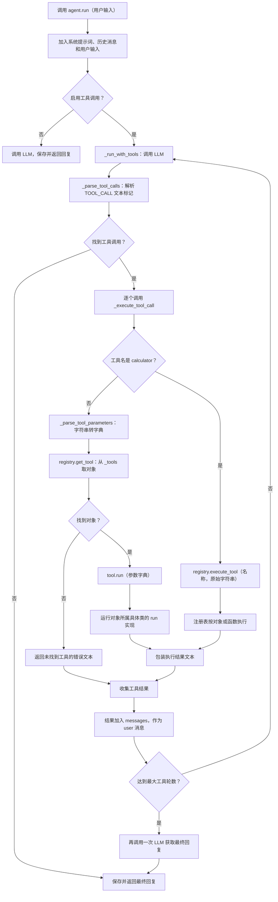

# MySimpleAgent 的工具调用：`tool.run(param_dict)`

## 阅读范围

- 项目代码：[`my_simple_agent.py`](../../../code/chapter7/my_simple_agent.py)，重点是 `run`、`_run_with_tools`、`_parse_tool_calls`、`_execute_tool_call` 和 `_parse_tool_parameters`。
- 框架代码：当前项目 `.venv` 中安装的 `hello-agents` **0.2.0**，主要是 `hello_agents/tools/registry.py` 和 `hello_agents/tools/base.py`。不同版本实现可能不同。

## 先回答：`run` 从哪里来？

`tool` 是工具注册表中保存的**工具对象**。执行 `tool.run(param_dict)` 时，Python 根据这个对象的实际类型查找 `run` 方法，并调用该类提供的实现。这里的 `run` 不是 `MySimpleAgent.run`，而是具体工具对象的 `run`。

框架里的 `Tool` 基类将 `run(self, parameters)` 定义为抽象方法；具体工具子类需要实现它。对象注册到 `ToolRegistry` 后，注册表按工具名保存对象，`get_tool` 再按名字取回同一个对象。

```python
registry.register_tool(search_tool)  # 内部：self._tools[search_tool.name] = search_tool
tool = registry.get_tool("search")  # 内部：self._tools.get("search")
result = tool.run({"query": "Python"})  # 调用具体工具类的 run
```

`tool.run(param_dict)` 中的 `param_dict` 是**一个位置参数**，不是 `**param_dict`。Python 调用绑定方法时自动传入 `self`，所以概念上等价于 `SearchTool.run(tool, param_dict)`；具体实现在哪个类，以工具对象的实际类型和继承关系为准。

## 完整流程图



上图省略异常分支：`_execute_tool_call` 会捕获执行过程中的异常并返回错误文本，该文本也会被作为工具结果交给模型。计算器分支中的 `execute_tool` 也有自己的异常处理。

## 一次具体调用

假设已使用 `register_tool` 注册名为 `search` 的工具对象，且模型输出：

```text
我先查询资料。[TOOL_CALL:search:Python 编程]
```

1. `_parse_tool_calls` 用正则表达式提取工具名 `search` 和参数字符串 `Python 编程`。这是**约定的文本格式**，不是模型 API 原生的结构化 tool calling。
2. `_execute_tool_call("search", "Python 编程")` 进入非 `calculator` 分支。
3. `_parse_tool_parameters` 因工具名为 `search`，将文本变为 `{"query": "Python 编程"}`；如输入 `query=Python,limit=3`，则按逗号和第一个等号拆分，得到的值都是字符串。
4. `get_tool("search")` 查找 `_tools` 字典。若找不到，返回错误文本；找到后调用 `tool.run(param_dict)`。
5. 工具返回结果后，Agent 包装结果、移除回复中的工具标记，把结果作为一条 `user` 消息加入对话，再请求 LLM 生成后续回复。

例如一个最小工具可以这样实现：

```python
from hello_agents import ToolRegistry
from hello_agents.tools import Tool


class SearchTool(Tool):
    def __init__(self):
        super().__init__(name="search", description="演示查询")

    def run(self, parameters: dict) -> str:
        query = parameters.get("query", "")
        return f"查询内容：{query}"

    def get_parameters(self) -> list:
        return []  # 演示用；真实工具应描述其参数


registry = ToolRegistry()
registry.register_tool(SearchTool())
tool = registry.get_tool("search")
assert tool is not None
print(tool.run({"query": "Python 编程"}))
# 查询内容：Python 编程
```

这里 `get_tool` 的返回类型允许为 `None`，实际代码在调用前也会检查。基类提供的 `validate_parameters` **不会因调用 `tool.run` 而自动执行**；如果需要校验，应由工具实现或调用方显式执行。

## 当前实现的边界

- **对象工具与函数工具不同**：`register_tool` 保存到 `_tools`，`register_function` 保存到 `_functions`；`get_tool` 只查询 `_tools`。目前除了精确名为 `calculator` 的特殊分支，`_execute_tool_call` 不会通过 `execute_tool` 查找函数工具。因而项目中的 [`my_calculator`](../../../code/chapter7/my_calculator_tool.py) 和 [`advanced_search`](../../../code/chapter7/my_advanced_search.py) 虽使用 `register_function` 注册并可出现在工具描述中，按当前代码以这些名字调用时会得到“未找到工具”。
- **计算器是特殊路径**：名称必须恰好是 `calculator`，代码才调用 `execute_tool(name, parameters)`。该注册表先查对象并传入 `{"input": input_text}`，再查函数并传入原始字符串；名称 `my_calculator` 不会进入这个分支。
- **参数解析较简单**：逗号和等号用于拆分，不支持带逗号的复杂值、转义、嵌套结构或自动类型转换；不含等号时，仅 `search` 和 `memory` 有专门映射，其他工具收到 `{"input": ...}`。
- **结果没有自动验证**：`tool.run` 的具体行为和返回格式取决于工具类；程序将返回值格式化为文本，未验证其业务是否成功。
- **轮次上限的最后调用**：达到 `max_tool_iterations` 后，代码再调用一次 LLM 获取回复，但不会再次解析该次回复里的工具标记。
- **流式方法不同**：`stream_run` 使用流式对话，不经过 `_run_with_tools`，不执行此处的工具调用流程。

## 如何自行确认调用了哪个实现

调试时可在 `get_tool` 后查看 `type(tool)`，再跳转到该类的 `run`。若类继承了父类的实现，也要继续查看继承链；若取到的是 `None`，应先检查工具注册方式和名称。
